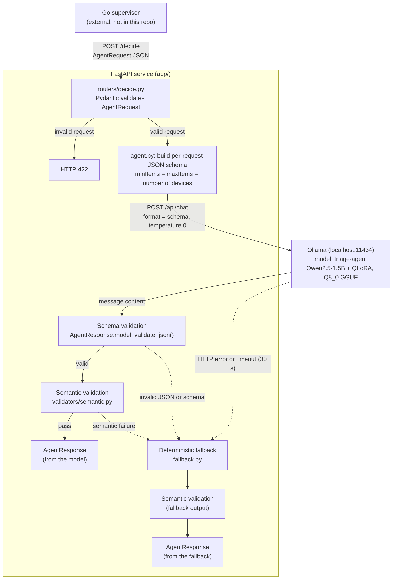
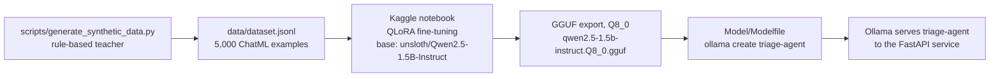

# Disaster Triage Agent

A local AI agent that decides what to do for each phone located in a disaster zone: send an evacuation SMS, flag the person for a rescue team, do both, or do nothing.

The model is **Qwen2.5-1.5B-Instruct**, fine-tuned with **QLoRA** on Kaggle, exported to **GGUF (Q8_0)** and served locally by **Ollama**. A **FastAPI** service puts three layers around the model: schema validation, semantic validation, and a deterministic fallback. Any valid request therefore gets a response that matches the contract and is consistent with the request, even when the model is slow, unavailable or wrong.

> **Status: working prototype.** 42/42 tests pass. In stress testing, 500 of 500 single-device requests were answered by the model with no fallback. Multi-device batches currently fall back often; see [Current limitations](#current-limitations).

---

## Contents

- [The problem](#the-problem)
- [Architecture](#architecture)
- [The model: from dataset to local model](#the-model-from-dataset-to-local-model)
  - [Training data](#training-data)
  - [Fine-tuning on Kaggle with QLoRA](#fine-tuning-on-kaggle-with-qlora)
  - [GGUF export](#gguf-export)
  - [Ollama integration](#ollama-integration)
- [The service: FastAPI and structured output](#the-service-fastapi-and-structured-output)
  - [The /decide endpoint](#the-decide-endpoint)
  - [Pydantic schemas](#pydantic-schemas)
  - [Structured JSON output with Ollama](#structured-json-output-with-ollama)
  - [Pinning the number of decisions](#pinning-the-number-of-decisions)
  - [System prompt](#system-prompt)
- [Reliability design](#reliability-design)
  - [Schema validation vs semantic validation](#schema-validation-vs-semantic-validation)
  - [Semantic checks](#semantic-checks)
  - [Deterministic fallback](#deterministic-fallback)
- [Testing](#testing)
- [Stress testing](#stress-testing)
- [Getting started](#getting-started)
- [Example request and response](#example-request-and-response)
- [Project structure](#project-structure)
- [Current limitations](#current-limitations)
- [Future improvements](#future-improvements)
- [Docker plan](#docker-plan)

---

## The problem

During an earthquake, flood or heatwave, a network operator can locate subscriber phones, check how each one can be reached (mobile data, SMS only, or not connected), and assign it to a danger zone (red, orange, green). That list then has to become actions:

- which people get an evacuation SMS, and what it says;
- which people cannot be reached and must be flagged for rescue, and with what priority;
- what to report to officials on a government dashboard;
- whether to request a network Quality-of-Service (QoS) boost for the zone.

This repository is the AI decision component of that pipeline. The contracts in [`contracts/`](contracts/) define the interface. A **Go supervisor** (not part of this repository) sends one request per zone batch, with up to 20 devices, to `POST /decide` and acts on the response immediately: dispatch, SMS, dashboard updates, and a CAMARA QoS on Demand call when `request_qos` is `true`.

The hard part is not getting an LLM to produce *a* decision. The hard part is producing output that a downstream system can act on without checking it by hand. Every response must:

1. parse and match the contract exactly;
2. contain exactly one decision per input device, with no invented, missing or duplicated phones;
3. be internally consistent (an `sms` action has SMS text, a `rescue_flag` has a rescue priority, and so on);
4. arrive within a bounded time, even when the model is slow, down or wrong.

A 1.5B-parameter local model cannot guarantee any of these on its own. So the design treats the model as one component behind several layers of checks, with a rule-based fallback underneath.

---

## Architecture



| Component | File | Responsibility |
|---|---|---|
| API | [`app/main.py`](app/main.py), [`app/routers/decide.py`](app/routers/decide.py) | FastAPI app and the `POST /decide` route |
| Schemas | [`app/schemas/request.py`](app/schemas/request.py), [`app/schemas/response.py`](app/schemas/response.py) | Pydantic `AgentRequest` and `AgentResponse` |
| Agent | [`app/agent.py`](app/agent.py) | Builds the Ollama request, calls the model, validates the output, falls back on failure |
| Semantic validator | [`app/validators/semantic.py`](app/validators/semantic.py) | Cross-checks the response against the request |
| Fallback | [`app/fallback.py`](app/fallback.py) | Rule-based response when the model path fails |
| Config | [`app/config.py`](app/config.py) | `OLLAMA_URL`, `OLLAMA_MODEL = "triage-agent"`, `OLLAMA_TIMEOUT = 30.0` |
| Model | [`Model/Modelfile`](Model/Modelfile), `Model/qwen2.5-1.5b-instruct.Q8_0.gguf` | The fine-tuned model, packaged for Ollama |

---

## The model: from dataset to local model



### Training data

[`scripts/generate_synthetic_data.py`](scripts/generate_synthetic_data.py) builds [`data/dataset.jsonl`](data/dataset.jsonl): **5,000 examples in ChatML format** (default `--num 5000`, `--seed 1337`). Each line is one conversation:

```json
{"messages": [
  {"role": "system",    "content": "You are an emergency disaster triage agent. Output valid JSON strictly conforming to the response schema."},
  {"role": "user",      "content": "<AgentRequest as compact JSON>"},
  {"role": "assistant", "content": "<AgentResponse as compact JSON>"}
]}
```

**How the targets are produced.** The script ports the deterministic earthquake-triage rules of a Go mock agent (`a.go`, not in this repository) to Python. It generates a synthetic request, runs it through those rules to get the target response, and validates **every pair** against the real Pydantic models in `app/schemas/` before writing it. Invalid pairs are never written. The rules:

| Batch zone | Reachable device (`CONNECTED_DATA` / `CONNECTED_SMS`) | `NOT_CONNECTED` device | `rescue_priority` when flagged | `confidence` |
|---|---|---|---|---|
| red | `both` | `rescue_flag` | 1 | 0.99 |
| orange | `both` | `rescue_flag` | 2 | 0.92 |
| green | `sms` | `none` | 0 | 0.75 |

In addition, `request_qos` is `true` when the zone is not green and at least one device is reachable. The SMS text is a zone-specific alert, plus a tsunami line when `tsunami_risk` is set, plus the nearest shelter's name (truncated to 120 characters) or *"Follow local authority instructions."* when there is no usable shelter.

**Coverage.** Zones are balanced (round-robin, then shuffled). Each batch has 1 to 20 devices. The ratio of reachable to unreachable devices is drawn per batch from a Beta(2, 1) distribution, so most batches are mostly reachable but some are catastrophic. Batches have 0 to 3 shelters, and some deliberately use whitespace-only names or names over 120 characters to exercise those branches. All congestion levels and QoS states appear, and about 30% of batches have tsunami risk. All 5,000 examples are earthquakes.

**Sequence length.** Measured with the model's own tokenizer (via Ollama's `prompt_eval_count`), the full training sequence is about 420 tokens for a 1-device batch, about 2,600 tokens for the median (12 devices), and about 5,330 tokens for the longest example (20 devices). The **6,144-token** context used in training and in the Modelfile covers the largest batch.

> **Why synthetic data from rules?** No labelled real-world triage data was available. A rule engine gives correct, consistent targets at any volume, and validating every pair against the production schemas guarantees the model never trains on a malformed response. The trade-off is that the model learns to *imitate the rules*, including their wording (see [Current limitations](#current-limitations)).

### Fine-tuning on Kaggle with QLoRA

Fine-tuning ran in a Kaggle notebook using Unsloth's checkpoint of the base model.

| Setting | Value |
|---|---|
| Base model | `unsloth/Qwen2.5-1.5B-Instruct` |
| Method | QLoRA (4-bit quantized frozen base + trainable LoRA adapters) |
| LoRA rank `r` | 16 |
| `lora_alpha` | 16 (scaling factor `alpha / r = 1.0`) |
| `max_seq_length` | 6144 |
| Training data | 5,000 ChatML examples (`data/dataset.jsonl`) |
| Training steps | ~200 |
| Training loss | ~0.45 at the start, ~0.0017 at the end |

> **TODO:** the notebook is not in this repository. (Empty placeholder notebooks were committed in `2abaa8f` and later removed.) The settings above are what was recorded. The learning rate, batch size, LoRA target modules, GPU type and full loss curve are not. Adding the notebook would make training reproducible.

**Why QLoRA.**

- **Memory.** QLoRA loads the base weights in 4-bit and freezes them, and trains only small low-rank adapter matrices. Optimizer state exists only for the adapters, not for all ~1.5B parameters. That keeps memory low enough to train on long (6,144-token) sequences on a Kaggle GPU.
- **Cost and speed.** With few trainable parameters, a full run is short (~200 steps), so it is cheap to iterate on the dataset and retrain.
- **The task is narrow.** The model must learn an output format and a mapping from inputs to decisions. It does not need new world knowledge. Low-rank adapters are enough for that, and keeping the base weights frozen preserves the base model's general language ability for the free-text fields.
- **r = 16, alpha = 16.** Rank 16 is a common middle ground: enough capacity for a structured-output task without making the adapter large. Setting `alpha = r` keeps the adapter's update scale at 1.0.

**Why Qwen2.5-1.5B-Instruct.** It is small enough to run locally at a few seconds per request. It is already instruction-tuned and uses ChatML, the same format as the dataset. The Qwen2.5 Instruct models were also trained with attention to structured output such as JSON.

**Reading the loss.** Training loss falling from ~0.45 to ~0.0017 means the model fit the training data almost perfectly. That is expected here, because the targets come from a deterministic function of the input. But it is **training** loss: no held-out validation set or evaluation metric was recorded. The checks downstream are the real measure of output quality: schema validation, semantic validation, and the stress test, where all 500 single-device responses passed both.

### GGUF export

After training, the model was exported to **GGUF**, the llama.cpp file format that Ollama loads, with **Q8_0** quantization:

```
Model/qwen2.5-1.5b-instruct.Q8_0.gguf   (~1.6 GB, stored with Git LFS)
```

The file is a standalone model with the fine-tuned weights included; it is not a separate adapter. `.gitattributes` routes `*.gguf` through Git LFS so the repository itself stays small.

**Why Q8_0.** 8-bit quantization stays very close to the original weights at about half the size of FP16. For a 1.5B model the Q8_0 file is already only ~1.6 GB, so there was little to gain by trading accuracy for a smaller 4-bit file. That matters for an output that must be valid JSON on every call. Smaller quantizations (Q4/Q5) have not been benchmarked in this repository.

### Ollama integration

[`Model/Modelfile`](Model/Modelfile) packages the GGUF for Ollama:

```
FROM ./qwen2.5-1.5b-instruct.Q8_0.gguf
TEMPLATE """...ChatML: <|im_start|>system / user / assistant ... <|im_end|>..."""
SYSTEM """You are an emergency disaster triage agent. Output valid JSON strictly conforming to the response schema."""
PARAMETER temperature 0
PARAMETER top_p 1
PARAMETER min_p 0
PARAMETER repeat_penalty 1.0
PARAMETER num_ctx 6144
PARAMETER num_predict 1500
PARAMETER stop "<|im_end|>"
PARAMETER stop "<|endoftext|>"
```

| Setting | Why |
|---|---|
| ChatML `TEMPLATE` | Same prompt format as the training data, so the model sees prompts shaped like the ones it was trained on |
| `SYSTEM` | Same system prompt as the training data (used when a client sends no system message) |
| `temperature 0`, `top_p 1`, `min_p 0` | Greedy decoding: the same input gives the same output, which makes behaviour reproducible and testable |
| `repeat_penalty 1.0` (disabled) | JSON repeats the same keys for every decision. A repetition penalty would push the model away from tokens it must repeat |
| `num_ctx 6144` | Matches `max_seq_length` used in training |
| `num_predict 1500` | Caps output length (see [Current limitations](#current-limitations): this is too low for large batches) |

The model is registered locally under the name **`triage-agent`**. That name must match `OLLAMA_MODEL` in [`app/config.py`](app/config.py).

---

## The service: FastAPI and structured output

### The /decide endpoint

```python
@router.post("/decide", response_model=AgentResponse)
async def decide(request: AgentRequest) -> AgentResponse:
    response = await run_agent(request)
    return response
```

The route is deliberately thin. FastAPI validates the body against `AgentRequest`, so a malformed request returns **HTTP 422** before any model call. `run_agent` does the work, and `response_model=AgentResponse` makes FastAPI validate and serialize the output against the contract. The handler is `async`, and the Ollama call uses `httpx.AsyncClient`, so the server does not block a worker while waiting on the model.

### Pydantic schemas

The Pydantic models are the single source of truth for the data format. The same classes are used to:

1. validate incoming requests (automatic 422 errors);
2. generate the JSON schema handed to Ollama to constrain generation;
3. validate the model's output;
4. drive FastAPI's response validation and OpenAPI docs (`/docs`).

`contracts/ai_request.json` and `contracts/ai_response.json` are the language-neutral JSON Schema contracts shared with the Go side. The tests load their `examples` as fixtures, so a change on either side that breaks the contract fails the suite.

**`AgentRequest`** ([`app/schemas/request.py`](app/schemas/request.py))

| Field | Type / constraint |
|---|---|
| `event_id` | string |
| `disaster_type` | `earthquake` \| `flood` \| `heatwave` |
| `severity` | float, 0–10 |
| `aftershock_risk` | `LOW` \| `MEDIUM` \| `HIGH` (optional) |
| `tsunami_risk` | bool (optional) |
| `zone` | `red` \| `orange` \| `green`; one zone per batch |
| `batch_index` | int ≥ 0 |
| `devices` | list of `TriagedDevice`, at most 20 |
| `nearest_shelters` | list of `Shelter`, at most 3 (optional) |
| `network_status` | `congestion_level`, `qos_status`, `sms_delivery_rate` (0–1, optional) |

Each `TriagedDevice` has a `phone` in E.164 format (`^\+[1-9]\d{1,14}$`), a bounded latitude and longitude, a `reachability_status` (`CONNECTED_DATA` \| `CONNECTED_SMS` \| `NOT_CONNECTED`), a `zone`, and optional location radius, timestamps and distance.

**`AgentResponse`** ([`app/schemas/response.py`](app/schemas/response.py)); extra fields are forbidden

| Field | Type / constraint |
|---|---|
| `event_id` | string (must echo the request) |
| `zone` | `red` \| `orange` \| `green` |
| `decisions` | list of `DeviceDecision`, at least 1 |
| `gov_narrative` | non-empty string, the situation report for officials |
| `request_qos` | bool |
| `confidence` | float, 0–1 |

Each `DeviceDecision` (extra fields forbidden) has a `phone`, `zone_confirmed`, `zone_escalated`, an `action` (`sms` \| `rescue_flag` \| `both` \| `none`), an `sms_message` (at most 320 characters), a `rescue_priority` (0–10), a `confidence` (0–1), and `reasoning` (an internal audit log that, per the contract, is never shown to end users).

`extra="forbid"` is deliberate. If the model adds a field the contract does not define, that is a sign it is drifting, and the response is rejected rather than silently trimmed.

### Structured JSON output with Ollama

Ollama's `/api/chat` accepts a `format` field containing a JSON schema and constrains generation to that schema. The agent passes the schema Pydantic generates from `AgentResponse`:

```python
schema = AgentResponse.model_json_schema()
...
"format": schema,
"options": {"temperature": 0},
"stream": False,
```

Fine-tuning teaches the model *what* to produce. Constrained decoding enforces the *shape* at generation time, so the model cannot emit an unknown `action` value or omit a required field. [`tests/manual_format_compare.py`](tests/manual_format_compare.py) is a manual script that sends the same request with and without `format`, so the two outputs can be compared side by side.

### Pinning the number of decisions

The static schema says `decisions` is an array with `minItems: 1` and no upper bound. In practice, **the fine-tuned model sometimes duplicated decisions, even when there was only one input device**, returning more decisions than there were devices. The static schema cannot reject this, because it allows any number of decisions greater than or equal to 1.

The fix is to build the schema **per request** and pin the array length to the number of input devices:

```python
def Generate_messages(request_json: str, device_count: int) -> dict:
    schema = AgentResponse.model_json_schema()
    schema["properties"]["decisions"]["minItems"] = device_count
    schema["properties"]["decisions"]["maxItems"] = device_count
```

This makes the decision count part of the constraint on generation itself. For a one-device request the model can produce exactly one decision, never two. It does not control *which* phones appear, which is why the system prompt and semantic validation below also exist.

### System prompt

`run_agent` sends this system message with every request:

```text
Return exactly one decision for each input device. Do not duplicate devices.
Do not invent devices. Do not omit devices. Each input phone must appear exactly
once in decisions. The number of decisions must equal the number of input devices.
```

Each sentence targets a specific failure mode: **duplicates** (the same phone twice), **invented devices** (a phone that was not in the request), and **missing devices** (a phone that was dropped). The schema pins the count, and the prompt steers the content. The [semantic validator](#semantic-checks) then verifies both, because a prompt is an instruction, not a guarantee.

Because `run_agent` sends its own system message, the Modelfile's default `SYSTEM` is not the one used for API calls. The training data used a different system prompt (see [Current limitations](#current-limitations)).

---

## Reliability design

Each layer catches what the previous one cannot:

| Layer | Where | What it guarantees |
|---|---|---|
| Request validation | FastAPI + `AgentRequest` | Bad input is rejected with 422 before reaching the model |
| Constrained decoding | Ollama `format` + pinned `minItems`/`maxItems` | Output has the right shape and the right number of decisions |
| Fine-tuning + system prompt | Model weights, `run_agent` | Output is *likely* to be correct in content |
| Schema validation | `AgentResponse.model_validate_json` | Output is a well-formed `AgentResponse` |
| Semantic validation | `semantic_validator(request, response)` | Output is a consistent answer *to this request* |
| Deterministic fallback | `fallback(request)` | A valid answer exists even when everything above fails |
| Response model | FastAPI `response_model=AgentResponse` | What leaves the API always matches the contract |

### Schema validation vs semantic validation

**Schema validation** answers: *is this a well-formed `AgentResponse`?* It looks at the response alone: types, enums, ranges, required fields, no extra fields, phones in E.164 format, SMS text at most 320 characters.

**Semantic validation** answers: *is this a correct, consistent answer to **this** request?* It needs the request and the response together.

The difference matters because a response can pass schema validation and still be useless. For example, this response is perfectly schema-valid:

- `event_id` is `"EQ-2024-999"` when the request was `"EQ-2024-001"`;
- it has a decision for `+212600000000`, a phone that was not in the batch;
- it has an `sms` action with an empty `sms_message`.

Only semantic validation rejects it.

### Semantic checks

[`app/validators/semantic.py`](app/validators/semantic.py) runs five checks in order. Any failure raises `SemanticValidationError` (a `ValueError` subclass), which triggers the fallback.

| Check | Function | Rule |
|---|---|---|
| Event ID matches | `ValidateEventId` | `response.event_id == request.event_id` |
| Zone matches | `ValidateZoneId` | `response.zone == request.zone` |
| Decision count matches | `ValidateDeviceDecisions` | `len(response.decisions) == len(request.devices)` |
| Every phone exists in the input | `ValidateDeviceDecisions` | the set of response phones equals the set of request phones: no invented phones, no missing phones |
| No duplicate phones | `ValidateDeviceDecisions` | follows from the two rules above (see below) |
| Zone escalation is consistent | `ValidateZoneEscalation` | `zone_confirmed` differs from the device's input zone **if and only if** `zone_escalated` is `true` |
| Action, SMS and priority are consistent | `ValidateActionConsistency` | see table below |

**How duplicates are caught.** If the counts are equal and the phone sets are equal, a duplicate is impossible. A repeated phone would force either a missing phone or an extra decision. With devices `{A, B}`, a response `[A, A]` passes the count check but fails the set check (`{A} ≠ {A, B}`). With device `{A}`, a response `[A, A]` fails the count check.

**Action consistency rules:**

| `action` | `sms_message` | `rescue_priority` |
|---|---|---|
| `sms` | must be non-empty | must be 0 |
| `rescue_flag` | must be empty | must be > 0 |
| `both` | must be non-empty | must be > 0 |
| `none` | must be empty | not checked |

These rules mirror what the Go supervisor does with each action: it sends `sms_message` as an SMS and dispatches by `rescue_priority`. A contradiction between them would result in an empty SMS being sent, or a rescue being requested with no priority.

### Deterministic fallback

[`app/fallback.py`](app/fallback.py) builds a complete `AgentResponse` from fixed rules, with no model involved.

**When it is used.** All failures on the model path go to the same place:

| Failure | How it shows up | Caught as |
|---|---|---|
| Ollama returns an HTTP error (e.g. 500, model not found) | `raise_for_status()` raises `httpx.HTTPStatusError` | `httpx.HTTPError` |
| Ollama is not running | `httpx.ConnectError` | `httpx.HTTPError` |
| Ollama takes longer than 30 s | `httpx.TimeoutException` | `httpx.HTTPError` |
| The model returns invalid JSON | Pydantic `ValidationError` (`json_invalid`) | `ValidationError` |
| Valid JSON, but the wrong schema | Pydantic `ValidationError` | `ValidationError` |
| Unexpected Ollama payload shape | `KeyError` / `TypeError` | `KeyError`, `TypeError` |
| Semantic validation fails | `SemanticValidationError` | `ValueError` |

Each failure is logged (`Ollama HTTP error: ...` or `AI response validation failed: ...`), and then the fallback runs.

**Fallback rules (per device):**

| Device zone | Reachability | `action` | `sms_message` | `rescue_priority` |
|---|---|---|---|---|
| red | `CONNECTED_SMS` | `sms` | `"Please evacuate immediately to the nearest shelter."` | 0 |
| red | `NOT_CONNECTED` | `rescue_flag` | `""` | 1 |
| anything else | any | `none` | `""` | 0 |

Every fallback decision keeps the device's own zone (`zone_escalated: false`), has `confidence: 0.5`, and its reasoning starts with `"Rule-based fallback: ..."`. At the batch level the fallback sets `request_qos: false`, `confidence: 0.5`, and a `gov_narrative` built from counts (devices processed, reachable, unreachable, SMS requested, rescue requested).

**Why this improves reliability.**

- **An outage of the model does not become an outage of the API.** If Ollama is down, slow or producing garbage, `/decide` still returns a contract-valid 200 response.
- **Bounded latency.** The model path is capped by the 30 s timeout. The fallback itself is a loop over at most 20 devices.
- **Deterministic and auditable.** The same input always gives the same output, and anyone can read the rules.
- **Visible to the consumer.** The low confidence (0.5) and the `Rule-based fallback` reasoning prefix let the supervisor, or the stress test, tell fallback answers apart from model answers.
- **The fallback is checked too.** Its output also passes through `semantic_validator`, and the tests assert that it does, so the safety net cannot quietly drift away from the contract.

---

## Testing

```bash
python -m pytest -q
# 42 passed
```

| File | Tests | What it covers |
|---|---|---|
| [`tests/test_schemas.py`](tests/test_schemas.py) | 5 | **Request schema.** The contract example parses. Rejected: missing `severity`, missing `network_status`, a phone without `+`, 21 devices |
| [`tests/test_schemas_response.py`](tests/test_schemas_response.py) | 6 | **Response schema.** The contract example parses. Rejected: unknown `action`, `rescue_priority` 11, SMS over 320 characters, missing `reasoning`, `confidence` 1.5 |
| [`tests/test_semantic.py`](tests/test_semantic.py) | 15 | **Semantic validation.** Each of the 5 validators accepts a valid pair. 10 failure cases: wrong event ID, wrong zone, count mismatch, unknown phone, duplicate phone, zone changed without escalation, escalation without zone change, `both` without SMS, `both` with priority 0, `none` with SMS |
| [`tests/test_fallback.py`](tests/test_fallback.py) | 9 | **Fallback.** red + SMS-reachable, red + unreachable, safe device, 8 mixed devices (order and actions), narrative counts. The fallback output passes `semantic_validator` in 4 scenarios |
| [`tests/test_agent.py`](tests/test_agent.py) | 5 | **Agent.** On success, asserts the exact payload sent to Ollama (system prompt, pinned `minItems`/`maxItems`, temperature 0). Invalid JSON, invalid schema, HTTP 500 and timeout each fall back to `fallback(request)` and log the error |
| [`tests/test_decide.py`](tests/test_decide.py) | 2 | **API.** `POST /decide` returns 200 with a valid `AgentResponse`. An empty body returns 422 |
| **Total** | **42** | **42 / 42 passing** |

**Strategy.**

- **One test file per layer**, matching the reliability layers above, so a failure points directly at the layer that broke.
- **Contract examples as fixtures.** The schema, agent and API tests load the `examples` from `contracts/*.json`, so the Pydantic models and the cross-language contract cannot silently diverge.
- **Ollama is mocked at the HTTP boundary** in `test_agent.py` (`httpx.AsyncClient.post` is patched), so the failure modes (HTTP 500, timeout, garbage JSON, wrong schema) can be injected on demand. The suite runs in a few seconds with no GPU or model.
- `test_decide.py` calls the real `run_agent`. If Ollama is running, it exercises the model. If not, the fallback answers. The test passes either way, which is the behaviour it is meant to guarantee.

---

## Stress testing

[`scripts/strees_test.py`](scripts/strees_test.py) measures how the full stack (FastAPI, Ollama and validation) behaves under load.

**How it works.**

- It sends *N* copies of the same request (an earthquake in the red zone with **one** `CONNECTED_SMS` device) to `/decide`.
- An `asyncio.Semaphore` limits how many requests are in flight at once (`--concurrency`, default **10**). The client timeout is 120 s.
- Each request's latency is measured end to end, from sending the request to receiving the full response.
- A request counts as **failed** if it returns a non-200 status or raises an exception. Successful responses are classified as **fallback** if any decision's `reasoning` starts with `"Rule-based fallback"`, and as **AI** otherwise.
- At the end it prints totals, total time, requests per second, average latency, P50, P95, P99, and the first 10 errors.

**What the metrics mean.**

- **Concurrency**: how many requests are open at the same time. Concurrency 1 means each request is sent only after the previous one finishes.
- **Latency**: the time one request takes, *including* any time spent waiting in a queue.
- **P50 / P95 / P99**: 50%, 95% and 99% of requests finished within this time. Averages hide slow outliers; the high percentiles (the "tail") show them.
- **AI vs fallback**: a 200 response is not necessarily a model response. Counting the two separately shows whether the model itself is keeping up, or whether the fallback is hiding a problem.

### Results

| Run | Requests | Concurrency | Successful | Failed | AI | Fallback | Avg | P50 | P95 | P99 |
|---|---|---|---|---|---|---|---|---|---|---|
| 1 | 500 | 1 | 500 | 0 | 500 | 0 | 3.92 s | 3.70 s | 5.27 s | 8.35 s |
| 2 | 50 | 3 | 50 | 0 | 50 | 0 | 9.29 s | not recorded | 9.81 s | 10.86 s |

**Interpretation.**

- **Concurrency 1.** All 500 requests were answered by the model and passed both schema and semantic validation. There were no fallbacks and no errors. The tail (P99 8.35 s) is about 2× the median.
- **Concurrency 3.** Still 50/50 AI responses, but average latency rose about 2.4× (3.92 s → 9.29 s). An approximate throughput can be derived with Little's law (concurrency ÷ average latency): about 0.26 req/s at concurrency 1 and about 0.32 req/s at concurrency 3. Tripling the concurrency raised throughput only about 25%. The extra latency is mostly **time spent queueing for the model**, not extra work.
- **Concurrency around 10.** In the runs at this level, Ollama saturated. Latency climbed, requests began to exceed the agent's 30 s `OLLAMA_TIMEOUT`, and the fallback took over. This is consistent with the numbers above: with ~3–4 s of model time per request, served mostly one at a time, the tenth request in line waits roughly 30–35 s. (Exact numbers for this run were not recorded.)

**Conclusion.** The bottleneck is local LLM inference, not the FastAPI logic. Validation and fallback are cheap Python on small payloads. Under overload, the timeouts happened on the Ollama call, and the requests that hit them were answered by the fallback. Scaling this service means scaling inference: more Ollama parallelism, a faster model or quantization, more hardware, or smaller workloads per call.

> **Scope of these results.** Every stress-test request contains a single device. Batches of 5–20 devices behave very differently today; see [Current limitations](#current-limitations). The hardware used for the stress runs was not recorded with the results. The development machine for this repository is an Apple M3 with 8 GB RAM running Ollama 0.34.4.

---

## Getting started

### Requirements

- macOS or Linux (developed on macOS, Apple Silicon)
- Python 3.9+ (the project's virtual environment uses Python 3.9.6)
- [Ollama](https://ollama.com) (developed with 0.34.4)
- [Git LFS](https://git-lfs.com), to download the ~1.6 GB GGUF model
- About 2 GB of free RAM for the model

### Installation

```bash
git clone git@github.com:geoDispatch/agent.git
cd agent
git lfs install
git lfs pull        # downloads Model/qwen2.5-1.5b-instruct.Q8_0.gguf
```

### Virtual environment

```bash
python3 -m venv .venv
source .venv/bin/activate
pip install -r requirements.txt
pip install uvicorn   # needed to run the server; not yet listed in requirements.txt
```

### Running Ollama

Start the Ollama server (or open the Ollama desktop app):

```bash
ollama serve
```

The agent expects it at `http://localhost:11434` (`OLLAMA_URL` in `app/config.py`).

### Creating the local model

The Modelfile references the GGUF with a relative path, so run `ollama create` from the `Model/` folder:

```bash
cd Model
ollama create triage-agent -f Modelfile
cd ..
ollama list           # should list triage-agent:latest
```

Optional: compare raw model output with and without the structured-output `format`:

```bash
python tests/manual_format_compare.py
```

### Running FastAPI

```bash
uvicorn app.main:app --port 5001
```

Port 5001 matches the stress test's default URL. (`contracts/ai_request.json` mentions port 5000 for the Go supervisor; use whichever port you like and pass `--url` to the stress test.) Interactive API docs are at http://localhost:5001/docs.

Send the contract's example request:

```bash
python -c "import json; print(json.dumps(json.load(open('contracts/ai_request.json'))['examples'][0]))" \
  | curl -s -X POST http://localhost:5001/decide \
      -H "Content-Type: application/json" -d @-
```

### Running tests

```bash
python -m pytest -q
```

No running model is required: the agent tests mock Ollama, and the API test falls back if Ollama is unavailable.

### Running stress tests

With Ollama and the API running:

```bash
python scripts/strees_test.py 500 --concurrency 1
python scripts/strees_test.py 50 --concurrency 3
python scripts/strees_test.py 50 --concurrency 10 --url http://localhost:5001/decide
```

The first positional argument is the number of requests. `--concurrency` defaults to 10, and `--url` defaults to `http://localhost:5001/decide`.

---

## Example request and response

**Request** (the example from [`contracts/ai_request.json`](contracts/ai_request.json)):

```json
{
  "event_id": "EQ-2024-001",
  "disaster_type": "earthquake",
  "severity": 6.8,
  "aftershock_risk": "HIGH",
  "tsunami_risk": false,
  "zone": "red",
  "batch_index": 0,
  "devices": [
    {
      "phone": "+212612345678",
      "latitude": 33.9716,
      "longitude": -6.8498,
      "location_radius_m": 500,
      "last_location_time": "2024-11-14T10:30:00Z",
      "reachability_status": "CONNECTED_SMS",
      "last_status_time": "2024-11-14T10:29:45Z",
      "zone": "red",
      "distance_km": 3.7
    }
  ],
  "nearest_shelters": [
    {
      "name": "École Ibn Battouta",
      "address": "Rue 14, Hay Riad, Rabat",
      "location": { "latitude": 33.98, "longitude": -6.86 },
      "distance_km": 1.2,
      "capacity": 300
    },
    {
      "name": "Complexe Sportif Al Amal",
      "address": "Avenue Hassan II, Rabat",
      "location": { "latitude": 33.985, "longitude": -6.855 },
      "distance_km": 2.1,
      "capacity": 500
    }
  ],
  "network_status": {
    "congestion_level": "HIGH",
    "sms_delivery_rate": 0.72,
    "qos_status": "active"
  }
}
```

**Response from the model**: actual output of `POST /decide` with the request above (`triage-agent`, 4.25 s):

```json
{
  "event_id": "EQ-2024-001",
  "zone": "red",
  "decisions": [
    {
      "phone": "+212612345678",
      "zone_escalated": false,
      "zone_confirmed": "red",
      "action": "both",
      "sms_message": "EARTHQUAKE ALERT (red zone): evacuate now, shelter at École Ibn Battouta.",
      "rescue_priority": 2,
      "confidence": 0.95,
      "reasoning": "mock rule: red zone, CONNECTED_SMS, action both"
    }
  ],
  "gov_narrative": "Mock agent (development tool), red zone batch 0: 1 device(s), 1 reachable, 0 unreachable. SMS requested for 1, rescue requested for 1.",
  "request_qos": true,
  "confidence": 0.95
}
```

This response passes schema and semantic validation. It also shows two things worth knowing. The model copies the wording of its rule-based training targets (`"mock rule: ..."`, `"Mock agent (development tool)"`). And it gave `rescue_priority: 2`, while the training rule for the red zone is 1. Semantic validation checks *consistency*, not *policy*, so this is accepted (see [Current limitations](#current-limitations)).

**Response from the fallback**, for the same request (what `/decide` returns if the model path fails):

```json
{
  "event_id": "EQ-2024-001",
  "zone": "red",
  "decisions": [
    {
      "phone": "+212612345678",
      "zone_escalated": false,
      "zone_confirmed": "red",
      "action": "sms",
      "sms_message": "Please evacuate immediately to the nearest shelter.",
      "rescue_priority": 0,
      "confidence": 0.5,
      "reasoning": "Rule-based fallback: red zone, CONNECTED_SMS, action sms."
    }
  ],
  "gov_narrative": "Red zone: 1 device(s) processed. 1 reachable, 0 unreachable. SMS requested for 1 device(s). Rescue requested for 0 device(s).",
  "request_qos": false,
  "confidence": 0.5
}
```

---

## Project structure

```
agent/
├── app/
│   ├── main.py                    # FastAPI app; mounts the /decide router
│   ├── config.py                  # OLLAMA_URL, OLLAMA_MODEL ("triage-agent"), OLLAMA_TIMEOUT (30 s)
│   ├── agent.py                   # run_agent(): prompt + per-request schema → Ollama → validation → fallback
│   ├── fallback.py                # deterministic rule-based AgentResponse
│   ├── routers/
│   │   └── decide.py              # POST /decide
│   ├── schemas/
│   │   ├── request.py             # AgentRequest, TriagedDevice, Shelter, NetworkStatus, enums
│   │   └── response.py            # AgentResponse, DeviceDecision, Action, ZoneConfig
│   └── validators/
│       └── semantic.py            # semantic_validator() and the individual checks
├── contracts/
│   ├── ai_request.json            # JSON Schema + example: Go supervisor → agent
│   └── ai_response.json           # JSON Schema + example: agent → Go supervisor
├── data/
│   └── dataset.jsonl              # 5,000 ChatML training examples (~38 MB)
├── Model/
│   ├── Modelfile                  # Ollama model definition (ChatML template, decoding params)
│   └── qwen2.5-1.5b-instruct.Q8_0.gguf   # fine-tuned model, Git LFS (~1.6 GB)
├── scripts/
│   ├── generate_synthetic_data.py # builds data/dataset.jsonl
│   └── strees_test.py             # async load test for /decide
├── tests/
│   ├── test_schemas.py            # request schema
│   ├── test_schemas_response.py   # response schema
│   ├── test_semantic.py           # semantic validation
│   ├── test_fallback.py           # fallback rules
│   ├── test_agent.py              # run_agent with Ollama mocked
│   ├── test_decide.py             # API endpoint
│   └── manual_format_compare.py   # manual: model output with vs. without `format`
├── Docs/REQUEST.md                # empty placeholder
├── Dockerfile                     # empty placeholder (see Docker plan)
├── .dockerignore
├── .env.example                   # empty placeholder
├── .gitattributes                 # *.gguf → Git LFS
└── requirements.txt
```

---

## Current limitations

**1. Multi-device batches mostly fall back today.** The stress test covers only one-device batches. Spot checks on the development machine (Apple M3, 8 GB RAM), one request each. The 1-device request is the contract example; the others are batches taken from `data/dataset.jsonl`:

| Devices | Latency | Result |
|---|---|---|
| 1 | 4.25 s | Model response, passed validation |
| 5 | 16.1 s | Fallback: semantic validation failed (`invalid action response`) |
| 10 | 30.1 s | Fallback: Ollama timed out at 30 s |
| 20 | 30.0 s | Fallback: Ollama timed out at 30 s |

There are two causes. Output length grows by roughly 125 tokens per device (a full 20-device response in the dataset is about 2,550 tokens), so generation time quickly exceeds the 30 s timeout. And even without the timeout, `num_predict 1500` in the Modelfile would cut off responses for batches beyond roughly 10–11 devices, which produces invalid JSON. The contract allows up to 20 devices per batch.

**2. Training and serving differ.**
- All 5,000 training examples are earthquakes, but the API also accepts `flood` and `heatwave`.
- The runtime system prompt (in `app/agent.py`) is different from the system prompt in the training data and the Modelfile.

**3. The model copies the wording of its training data.** The rule-based targets came from a *mock* agent, and the model reproduces phrases such as `"Mock agent (development tool)"` in `gov_narrative`, a field the contract says is shown to officials.

**4. Semantic validation checks consistency, not policy.**
- It does not check that the priority is right for the zone (the example above has priority 2 for red, against a training rule of 1).
- It does not check that an escalation goes *upward* (red → green marked as "escalated" would pass).
- It does not check that the SMS names the right shelter, or that `none` has priority 0.
- `ValidateZoneEscalation` pairs devices and decisions **by position** (`zip`), while the contract says decisions may be in any order.

**5. The fallback policy is incomplete and differs from the training rules.** A red-zone device on `CONNECTED_DATA` gets `none`, so a reachable person in the most dangerous zone receives no SMS. Orange-zone devices are never flagged, and `request_qos` is always `false`. The training rules instead give red and orange reachable devices `both`. This policy is still to be decided.

**6. An empty `devices` list returns HTTP 500.** `AgentRequest` accepts 0 devices, but the contract requires at least 1, and `AgentResponse` requires at least 1 decision, so the fallback raises a `ValidationError`. The Pydantic request model is also generally more permissive than `contracts/ai_request.json`: several fields are optional there but required in the contract, and extra fields are not forbidden.

**7. Training is not reproducible from this repository.** The Kaggle notebook, the full training configuration and the loss log are missing, and there is no held-out evaluation set.

**8. Serving is single-instance.** One local Ollama process serves requests roughly one at a time. The timeout, URL and model name are hard-coded constants (`.env.example` is empty). Logging uses `print`.

**9. Packaging gaps.** `uvicorn` is missing from `requirements.txt`. Versions are not pinned, and `httpx2` is listed but never imported. `Dockerfile` and `Docs/REQUEST.md` are empty. `app/routers/decide.py` builds a `contracts/ai_response.json` path and edits `sys.path`, but uses neither.

---

## Future improvements

**Make multi-device batches work.**
- Raise `num_predict`, or set it per request from the device count. Scale the timeout with batch size.
- Or split large batches into smaller sub-batches and merge the results. The semantic validator already checks the merged result.
- Add a `--devices` option to the stress test and benchmark latency and fallback rate against batch size.

**Improve the data and the model.**
- Regenerate the dataset without mock-agent wording in `reasoning` and `gov_narrative`.
- Add flood and heatwave scenarios, and use the runtime system prompt in the training data.
- Hold out an evaluation split and report per-field accuracy and the validation pass rate, not only training loss.
- Commit the Kaggle notebook and the training configuration.
- Benchmark Q4_K_M / Q5_K_M quantizations for latency against validity.

**Tighten validation and the fallback.**
- Pair decisions to devices by phone, not by position.
- Add policy checks: priority per zone, upward-only escalation, and `none` implies priority 0.
- Decide the fallback policy (red + `CONNECTED_DATA`, orange zone, `request_qos`) and align it with the training rules.
- Fall back only for the decisions that fail a check, instead of replacing the whole batch.

**Harden the service.**
- Move configuration to environment variables. Use structured logging. Expose metrics for fallback rate and fallback reason.
- Tune `OLLAMA_NUM_PARALLEL` within memory limits. Add backpressure, so the service returns the fallback early when the queue is long instead of waiting 30 s.
- Add tests for the semantic-failure → fallback path in `run_agent` (currently covered only at the validator level) and for the empty-devices case.
- Pin dependencies and add `uvicorn` to `requirements.txt`.

---

## Docker plan

Not implemented yet. `Dockerfile` is an empty placeholder, and the existing `.dockerignore` was written for an earlier project layout and needs review. The planned setup:

1. **Make configuration environment-driven first.** `OLLAMA_URL` must point to `http://ollama:11434` inside Compose instead of the hard-coded `localhost`.
2. **API image.** Start from a slim Python base image. Install the pinned requirements (including `uvicorn`). Copy only `app/` (and `contracts/` if needed at runtime). Run `uvicorn app.main:app --host 0.0.0.0 --port 5001`. Exclude `Model/*.gguf`, `data/` and `.venv/` from the build context.
3. **Ollama service.** Use the official `ollama/ollama` image with a named volume for models. Mount `Model/` and run `ollama create triage-agent -f Modelfile` once as a provisioning step.
4. **docker-compose.** Two services with health checks; the API starts once Ollama is healthy and the model exists.
5. **macOS caveat.** Docker on macOS cannot use the Apple GPU, so Ollama in a container would run on CPU only and be slower than native. For Mac development, run Ollama natively and containerize only the API, pointing it at `http://host.docker.internal:11434`. Use the full two-container setup on Linux hosts with a GPU.
